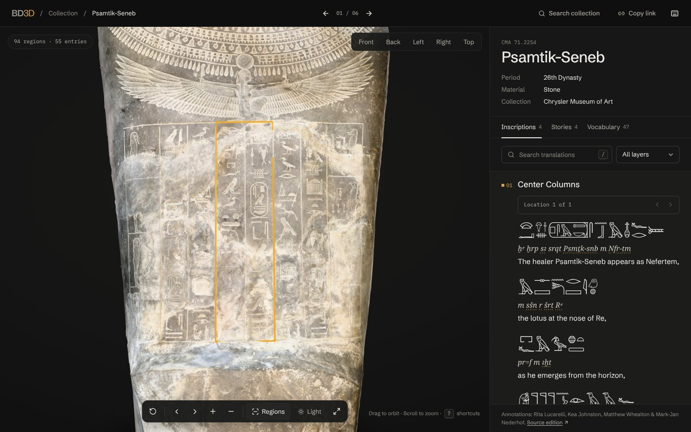
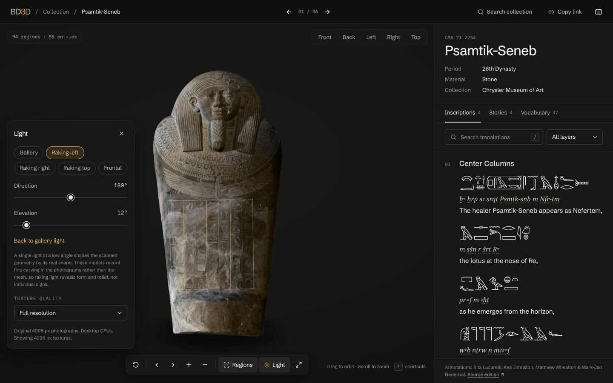
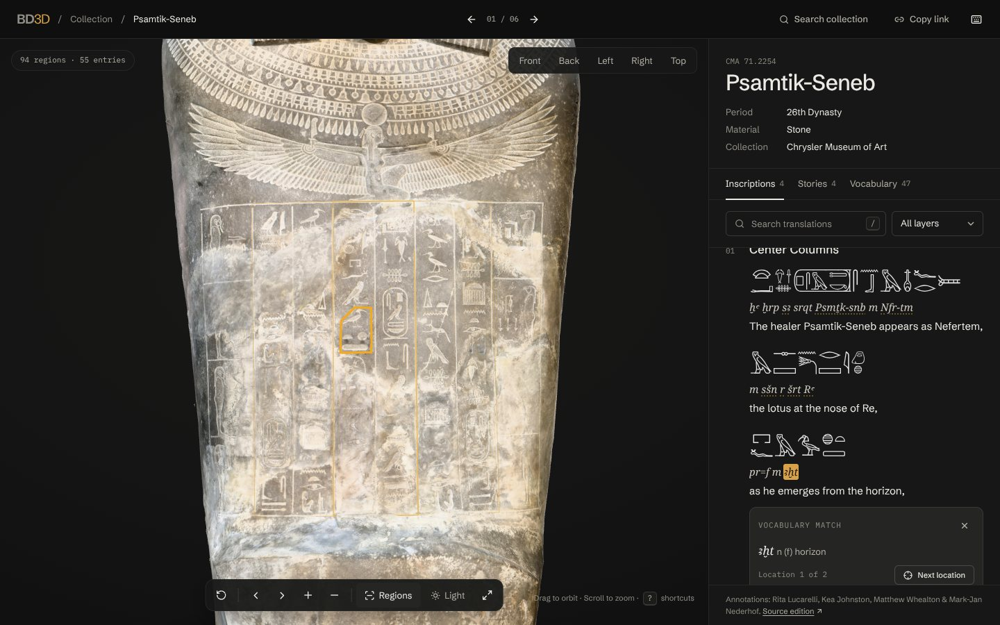
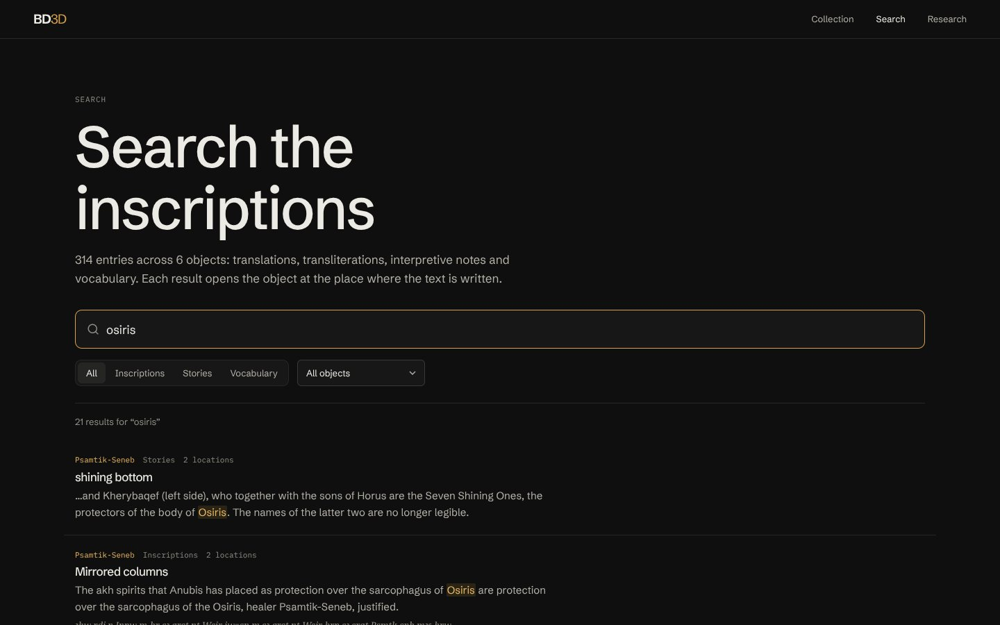
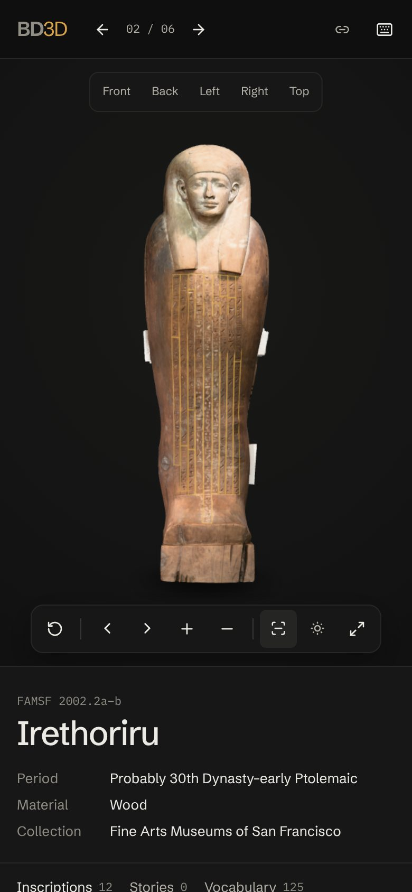
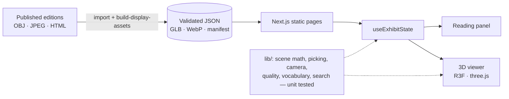

# BD3D · The Book of the Dead in 3D

Read ancient Egyptian coffins where the words were written. BD3D is a research viewer for six photogrammetric coffin models from the UC Berkeley Book of the Dead in 3D project. Every annotated inscription is mapped to its place on the surface and shown as hieroglyphs, transliteration and translation.



|                                                         |                                                              |
| ------------------------------------------------------- | ------------------------------------------------------------ |
|       |        |
| Raking light: a real directional light with shadow maps | A transliterated word, its dictionary entry and its location |
|        |                 |
| Search across all 314 entries                           | Phone layout                                                 |

## What it does

- **Read from the object or from the text.** Click an outlined region to open its entry; choose an entry and the camera flies to where it is written. Hover either side and the other lights up.
- **Interlinear reading.** Hieroglyphs (Mark-Jan Nederhof's ResLite renderer), transliteration and translation, line by line, with layer filters.
- **Words to places.** Words in a transliteration link to the edition's vocabulary by exact spelling and show every location of that word on the object.
- **Raking light.** Direction and elevation controls plus presets, using real lighting on the scanned geometry.
- **Collection search** across translations, transliterations, notes and vocabulary for all six objects.
- **Shareable views.** The URL holds the selected region, camera view and light (`/exhibits/psamtikseneb?region=text%3Acenter&light=180,12`).
- **Keyboard-first.** `R` reset · `1`–`5` views · `[` `]` locations · `O` outlines · `L` light · `F` expand · `/` search · `?` help.

## Engineering highlights

|                                       |                                                                                                                                                                                                                                                          |
| ------------------------------------- | -------------------------------------------------------------------------------------------------------------------------------------------------------------------------------------------------------------------------------------------------------- |
| **Asset pipeline with provenance**    | OBJ + 4096 px JPEGs → meshopt-compressed, 16-bit quantized glTF and WebP tiers. Sources untouched; every derivative records its own and its source's SHA-256; tests check compressed geometry against the source within 1/10,000 of the object's length. |
| **Progressive, device-aware loading** | Geometry and 1024 px textures first, preloaded from the HTML and streamed with byte-level progress; then 2048 or 4096 px chosen from GPU limits, memory, connection and input type. Resources are disposed on exit.                                      |
| **Exact picking**                     | The source viewer's projected-polygon rule, with back-face rejection; hover without per-move mesh raycasts.                                                                                                                                              |
| **Batched overlays**                  | Region outlines in at most four draw calls (one per state) instead of up to 265.                                                                                                                                                                         |
| **Faithful colour**                   | Khronos PBR Neutral tone mapping, sRGB textures, image-based ambient light, viewer-relative key and fill lights.                                                                                                                                         |
| **Validated research data**           | zod schema and two-way link checks on every edition at build time.                                                                                                                                                                                       |
| **Tests**                             | 82 unit tests, 46 Playwright end-to-end tests with axe accessibility scans, all in CI.                                                                                                                                                                   |

### Measured results

Same harness before and after ([details](docs/PERFORMANCE.md)):

|                                                   | Before      | After      |
| ------------------------------------------------- | ----------- | ---------- |
| Exhibit download (standard quality)               | 4.8–20.2 MB | 1.9–6.1 MB |
| Geometry download                                 | 1.9–3.3 MB  | 0.4–1.0 MB |
| Geometry parse                                    | 82–132 ms   | 2–3 ms     |
| GPU texture memory, phones and tablets (computed) | ≈341 MB     | ≈85 MB     |
| First frame with the model (software WebGL)       | 1.8–4.2 s   | 0.9–1.8 s  |

Open issue: in software-rendered WebGL, reaching full-resolution textures is slower than before. The cost is in the texture upload and is not yet attributed; it is unmeasured on GPU hardware. See [PERFORMANCE.md](docs/PERFORMANCE.md#time-to-first-frame).

## Architecture



- [Architecture](docs/ARCHITECTURE.md): layers, state, keyboard and accessibility, testing.
- [Rendering and annotation pipeline](docs/RENDERING.md): derivatives, loading, quality tiers, coordinate spaces, picking, lighting.
- [Performance](docs/PERFORMANCE.md): methodology and before/after numbers.
- [Audit](docs/AUDIT.md) and [roadmap](docs/ROADMAP.md).
- [Case study](docs/CASE-STUDY.md) and [demo video plan](docs/DEMO.md).

## Run it

Requires Node.js 22.

```sh
npm ci
npm run dev          # http://localhost:3000
```

Production build:

```sh
npm run build
npm run start -- --port 3101
```

No environment variables or database are needed. Set `NEXT_PUBLIC_SITE_URL` when deploying so social previews use absolute URLs.

## Test it

```sh
npm run check        # format, lint, types, unit tests
npm run verify:data  # source asset checksums
npm run build && npm run start -- --port 3101 &
npm run test:e2e     # Playwright against :3101
```

The end-to-end suite uses installed Google Chrome by default. On machines without Chrome or a GPU (as in CI):

```sh
npx playwright install chromium
PLAYWRIGHT_CHANNEL= PLAYWRIGHT_SOFTWARE_GL=1 PLAYWRIGHT_EXPECT_TIMEOUT=45000 npm run test:e2e
```

## Data

- `data/coffins/*.json`: 314 entries and 607 regions imported from the published St Andrews editions by `scripts/import-nederhof.mjs`.
- `data/import-manifest.json`: source URLs, sizes and SHA-256 for every imported file.
- `data/display-assets.json`: web derivatives built by `npm run build:assets`, each with its source hash.

Missing mappings are not invented, display units are not physical units, and no surface detail is inferred from photographs. The [research page](app/research/page.tsx) lists sources, transformations and open questions for scholarly review.

## Credits

Annotation editions: Rita Lucarelli, Kea Johnston and Mark-Jan Nederhof (Psamtik-Seneb also Matthew Whealton). Models hosted by the University of St Andrews for the UC Berkeley project. Collection photographs © Chrysler Museum of Art, Fine Arts Museums of San Francisco and Phoebe A. Hearst Museum of Anthropology. Method: Lucarelli and Nederhof, “Digitizing and Annotating Ancient Egyptian Coffins: The Book of the Dead in 3D” (2023), [doi:10.1163/9789004501294_011](https://doi.org/10.1163/9789004501294_011).

The original prototype's notes are in [docs/ORIGINAL-PROTOTYPE.md](docs/ORIGINAL-PROTOTYPE.md); the redesign validation log is in [docs/VALIDATION.md](docs/VALIDATION.md).
