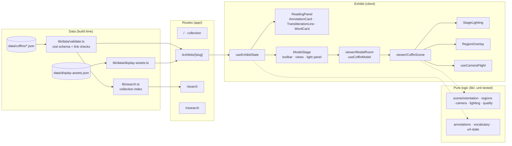

# Architecture

BD3D connects three things: a photogrammetric model, the surface regions an editor drew on it, and the scholarly entries those regions point to. Every module below exists to keep those three aligned and fast to explore. The asset and rendering pipeline is described in [RENDERING.md](RENDERING.md).

## Layers

| Layer            | Location                                                                       | Notes                                                                                                                                                  |
| ---------------- | ------------------------------------------------------------------------------ | ------------------------------------------------------------------------------------------------------------------------------------------------------ |
| Data model       | `lib/data/schema.ts`                                                           | zod schema; the single source of edition types.                                                                                                        |
| Validation       | `lib/data/validate.ts`                                                         | Schema plus referential checks (every region links to an entry and back, ids unique). A bad import fails the build.                                    |
| Display assets   | `lib/data/display-assets.ts`                                                   | Typed view of `data/display-assets.json`: derivative URLs, sizes, hashes, download and texture-memory calculations.                                    |
| Catalogue        | `lib/collection.ts`                                                            | Object metadata and edition credits.                                                                                                                   |
| Annotation logic | `lib/annotations.ts`, `lib/vocabulary.ts`, `lib/search.ts`, `lib/url-state.ts` | Filtering, location cycling, headword lookup, collection search ranking, shareable link parsing.                                                       |
| Scene logic      | `lib/scene/*.ts`                                                               | Orientation and normalization, polygon picking, camera poses and named views, raking-light geometry, device quality tiers, asset loading and disposal. |
| Viewer           | `app/components/viewer/`                                                       | Canvas, progressive loader hook, scene, lighting, batched overlay, camera flights.                                                                     |
| Exhibit UI       | `app/components/exhibit/`                                                      | One state hook (`useExhibitState`) and presentational components.                                                                                      |
| Site             | `app/components/site`, `home`, `search`                                        | Header, footer, collection browser, search client.                                                                                                     |
| Styles           | `app/styles/`                                                                  | `tokens.css` (design tokens), `base.css` (controls), `site.css`, `viewer.css`. No CSS framework.                                                       |

Anything that can be computed without React or WebGL lives in `lib/` and has unit tests. Components compose those results.

## State

`useExhibitState` owns every piece of exhibit state and the transitions between them:

- **Selection:** one selected region at a time. Selecting from the model switches to the entry's tab and scrolls it into view; selecting from the panel flies the camera to the entry's first location. Choosing a vocabulary location from a word card keeps the reader on the inscription.
- **Related regions:** the selected entry's other locations, the entry under the pointer in the panel, and the locations of a highlighted word. These are outlined in the "related" style even when they belong to another tab.
- **Hover:** region under the pointer on the model (highlights the card) and card under the pointer in the panel (highlights its regions).
- **Camera:** named commands (`reset`, `in`, `out`, `left`, `right`, `view:front` …), each with a serial number so repeating a command re-runs it.
- **Lighting:** `gallery` or `raking` with azimuth and elevation.
- **Link state:** selection, view and raking light are mirrored into the query string (`?region=…&view=…&light=az,el`) with `history.replaceState`, and applied once when the model is ready.

Quality (`auto`, `low`, `standard`, `high`) is per browser, stored with `useSyncExternalStore` over local storage, and resolved against the device profile once the WebGL context reports `MAX_TEXTURE_SIZE`.

## Keyboard and accessibility

- Shortcuts: `R` reset, `1`–`5` views, `[` `]` locations, `O` outlines, `L` light panel, `F` expand, `/` search, `?` reference, `Esc` close. Ignored while typing.
- Every camera action has a button; the canvas is never the only way to reach content.
- Tabs follow the ARIA tabs pattern with arrow keys; the expanded model is a modal dialog with a focus trap that returns focus to its trigger.
- Reduced-motion preference: camera flights arrive immediately and CSS transitions are disabled.
- Automated axe scans run on every page type at desktop and phone widths.

## Testing

| Level      | Tool                            | Covers                                                                                                                                                                                                                                                                                                  |
| ---------- | ------------------------------- | ------------------------------------------------------------------------------------------------------------------------------------------------------------------------------------------------------------------------------------------------------------------------------------------------------- |
| Unit       | Vitest (`npm test`)             | Edition validity and integrity checks; derivative hashes and geometry bounds against the source OBJ; search ranking; vocabulary matching; link parsing; quality selection; light geometry; hit testing; camera poses; orientation                                                                       |
| End to end | Playwright (`npm run test:e2e`) | Each exhibit's loading, failure and retry, picking from the model, camera controls, layers, repeated locations, keyboard, reduced motion, mobile layout; deep links; raking light; vocabulary linking; shortcuts; batched draw calls; progressive texture tiers; collection search; accessibility scans |
| Data       | `npm run verify:data`           | Source asset sizes and SHA-256 against the import manifest                                                                                                                                                                                                                                              |

CI (`.github/workflows/ci.yml`) runs all of these on every push and pull request. End-to-end tests use bundled Chromium with software WebGL, so the readiness timeout is raised there.
