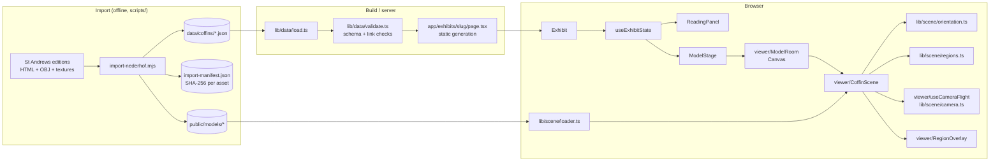

# Architecture

BD3D connects three things: a photogrammetric model, the surface regions an editor drew on it, and the scholarly entries those regions point to. Every module below exists to keep those three aligned.

## Layers

| Layer            | Location                  | Depends on               | Notes                                                                                                                                      |
| ---------------- | ------------------------- | ------------------------ | ------------------------------------------------------------------------------------------------------------------------------------------ |
| Data model       | `lib/data/schema.ts`      | zod                      | Single source of truth for edition types (`Region`, `Annotation`, `CoffinData`).                                                           |
| Validation       | `lib/data/validate.ts`    | schema                   | Schema parse plus referential checks: every region links to an entry and back, ids unique. Throws `CoffinDataError` listing every problem. |
| Loading          | `lib/data/load.ts`        | validation               | Server-only. A bad import fails the build, not the 3D scene.                                                                               |
| Catalogue        | `lib/collection.ts`       | —                        | Object metadata shown in the UI (names, accessions, collections, credits).                                                                 |
| Annotation logic | `lib/annotations.ts`      | schema                   | Search, tab order, location cycling, layer visibility. Pure functions.                                                                     |
| Scene math       | `lib/scene/*.ts`          | three                    | Source orientation and display normalization, region hit testing and outlines, camera poses. Pure functions, no React.                     |
| Viewer           | `app/components/viewer/`  | scene math, R3F          | Canvas, error boundary, loading state, scene, overlay, camera flight.                                                                      |
| Exhibit UI       | `app/components/exhibit/` | annotation logic, viewer | State hook plus presentational components.                                                                                                 |

The rule between layers: anything that can be computed without React or WebGL lives in `lib/` and has unit tests. Components compose those results.

## Coordinate spaces

Region vertices are stored in the source model's space, exactly as the edition recorded them. `prepareDisplayModel` computes one matrix (source orientation, then centring and uniform scaling so the longest side is 4 units) and applies it to the mesh. The same matrix transforms region vertices for picking, outlines and camera targets. Nothing else rotates or scales the model, so mesh and annotations cannot drift apart.

Display units are not physical units. See the audit for why measurement tools wait for confirmed source units.

## Selection flow

1. **From the model:** a click on the mesh gives a pointer position and hit point. `findRegionAt` keeps regions facing the camera and applies the source viewer's projected-polygon test. The exhibit state selects that region, switches to its entry's tab and scrolls the entry into view.
2. **From the panel:** choosing an entry selects its first region. Location arrows cycle through the entry's other regions.
3. **Camera:** whenever the selected region or `focusSerial` changes, `useCameraFlight` flies to `focusOnRegion` (the region's centroid, backed off along its recorded viewing direction). Dragging cancels a flight.

## Rendering

The canvas renders on demand (`frameloop="demand"`): frames are drawn only while the camera moves or state changes. Device pixel ratio is capped at 1.5. Model assets load only for the opened exhibit; `CoffinLoader` resolves only after the geometry and every texture have loaded, so a missing texture surfaces as an error instead of an untextured model.

## Testing

| Level      | Tool                            | Covers                                                                                                                                                                           |
| ---------- | ------------------------------- | -------------------------------------------------------------------------------------------------------------------------------------------------------------------------------- |
| Unit       | Vitest (`npm test`)             | Data validity of all six editions, integrity checks, search, location cycling, hit testing, camera poses, orientation and normalization                                          |
| End to end | Playwright (`npm run test:e2e`) | Each exhibit: asset isolation, loading, failure and retry, picking from the model, camera controls, layers, repeated locations, keyboard and reduced motion, accessibility scans |
| Data       | `npm run verify:data`           | Asset sizes and SHA-256 against the import manifest; coordinates against cached source pages when present                                                                        |

CI (`.github/workflows/ci.yml`) runs all of these on every push to `main`, `redesign/**` and `codex/**` and on pull requests. End-to-end tests run on bundled Chromium with software WebGL, so the readiness timeout is raised (`PLAYWRIGHT_EXPECT_TIMEOUT=45000`); model readiness took 2.8–8.7 s per exhibit on CPU rendering in the baseline.
