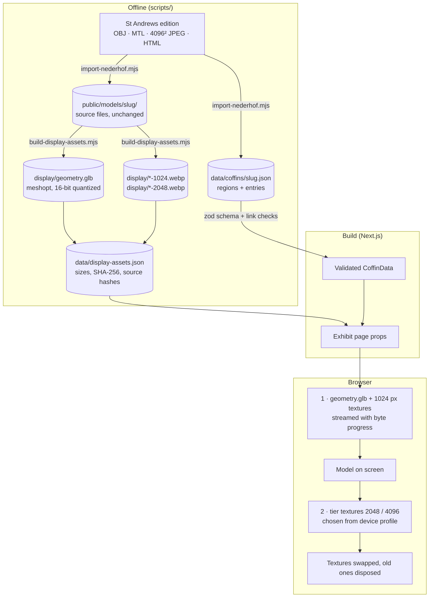

# Rendering and annotation pipeline

How a photogrammetric coffin and its scholarly annotations get from the published editions to the reader's screen, and why each step is the way it is.

## 1. Display derivatives

`scripts/build-display-assets.mjs` reads each source OBJ with three's `OBJLoader` and writes a glTF binary with glTF-Transform:

| Step                               | What it does                                                                               | Why                                                                                                                                      |
| ---------------------------------- | ------------------------------------------------------------------------------------------ | ---------------------------------------------------------------------------------------------------------------------------------------- |
| Merge identical vertices (`weld`)  | Vertices with identical position, normal and UV become one indexed vertex. None are moved. | OBJ stores one vertex per triangle corner; indexing is what makes compression effective.                                                 |
| Flip V                             | `v' = 1 − v`                                                                               | glTF convention; textures can then be uploaded from `ImageBitmap` without a flip.                                                        |
| Smooth normals, only where missing | Area-weighted face normals summed per shared position.                                     | Iwefaa and Psamtik ship without normals; three would otherwise shade them faceted. Derived from the model's own geometry, nothing added. |
| Reorder                            | meshoptimizer vertex-cache and fetch order.                                                | Better GPU cache use and better compression.                                                                                             |
| Quantize                           | Positions 16 bit, UVs 16 bit, normals 10 bit (`KHR_mesh_quantization`).                    | 16 bits over the longest side is an error below 1/10,000 of the object, checked by a unit test against the source OBJ bounds.            |
| Compress                           | `EXT_meshopt_compression`                                                                  | Decoded in the browser by the small WebAssembly decoder that ships with three.js.                                                        |

Textures: 1024 and 2048 px WebP (quality 82 and 88, Lanczos downscaling). The 4096 tier is the original JPEG, so the full-resolution view never shows a re-encoded image.

Every derivative records its byte size and SHA-256 together with the hash of the source file it came from (`data/display-assets.json`). `lib/data/display-assets.test.ts` re-hashes all of them on every CI run.

## 2. Loading

`useCoffinModel` (`app/components/viewer/useCoffinModel.ts`):

1. The server-rendered page preloads `geometry.glb` and the 1024 px textures, so downloads start while JavaScript loads; the loader's `fetch()` calls reuse those responses. Geometry and textures are fetched in parallel. Bodies are read as streams, so the progress bar shows real bytes against the manifest total.
2. Decodes images with `createImageBitmap`, which decodes off the main thread in current browsers.
3. Marks the model ready and renders it.
4. Fetches the target tier in the background, uploads one texture per animation frame (`renderer.initTexture`), then swaps each material's map and disposes the preview textures. Anisotropic filtering is set when each texture is created, so no texture is ever uploaded twice.
5. On unmount (leaving the exhibit) aborts in-flight requests and disposes geometry, materials and textures.

Errors are typed (`AssetLoadError`). A failed geometry or preview texture shows a retry panel while the reading panel keeps working; a failed upgrade keeps the preview and says so.

## 3. Device-aware quality

`lib/scene/quality.ts`, unit tested:

| Level           | Textures | Max DPR | Anisotropy | Shadows | Chosen when                                                 |
| --------------- | -------- | ------- | ---------- | ------- | ----------------------------------------------------------- |
| Low             | 1024     | 1       | 2×         | off     | `MAX_TEXTURE_SIZE` < 2048, Save-Data, 2G, ≤ 2 GB memory     |
| Standard        | 2048     | 1.5     | 4×         | on      | touch devices, 3G, < 8 GB memory, `MAX_TEXTURE_SIZE` < 4096 |
| Full resolution | 4096     | 2       | 8×         | on      | everything else                                             |

Missing hints (Safari and Firefox expose no memory or connection information) count as capable; texture-size limits are hard limits. The reader can override the choice; the override is remembered in local storage when available.

## 4. Coordinate spaces

Region polygons stay in the source model's coordinates. `prepareDisplayModel` builds one matrix (the edition's recorded orientation, then centring and uniform scaling to a longest side of 4 units) and uses it for the mesh, for picking, for outlines and for camera targets. Because the glTF keeps the source coordinate frame (quantization is undone by a node transform), the same matrix that aligned the OBJ aligns the glTF.

## 5. Picking and region states

- **Click:** R3F raycasts the mesh; the hit point is used only to reject back-facing regions, then the source viewer's projected-polygon winding test decides which region was clicked.
- **Hover:** no mesh raycast. On pointer move (once per animation frame), regions facing the camera at their centroid are tested with the same polygon rule. This keeps hover cheap on 50,000-triangle meshes.
- **Drawing:** outlines are grouped by state (idle, related, hovered, selected) into at most four `LineSegments2` meshes, instead of one mesh per region (265 on Irethoriru). An end-to-end test asserts fewer than 40 draw calls per frame.

## 6. Lighting and colour

- `NeutralToneMapping` (Khronos PBR Neutral) and sRGB textures, so the photographed colour of the object is kept rather than pushed towards a filmic look.
- Image-based ambient light from three's `RoomEnvironment` through a PMREM, plus a key light and a weak fill.
- Lights are defined relative to the camera, so "from the left" always means screen-left.
- **Raking light** turns the environment down to 6 % and uses a single directional light at the chosen azimuth and elevation, with a 2048² shadow map. It shades the scanned geometry by its real shape. The meshes have mean edge lengths of 1/84 to 1/166 of the object's length, so carved signs are in the photographs, not the geometry. Raking light therefore reveals form and relief, not individual signs; the interface says so. Relief is never estimated from the photographs.
- A contact shadow, rendered once, grounds the object.
- Rendering is on demand: frames are drawn only when the camera, lighting or selection changes.

## 7. What better data would unlock

| Data                                                    | Feature                                                                     |
| ------------------------------------------------------- | --------------------------------------------------------------------------- |
| High-resolution photogrammetry meshes                   | Normal maps baked onto the display meshes, so raking light reveals carving. |
| Confirmed model units                                   | Measurement tools.                                                          |
| Word-level alignment of transliteration and translation | Highlighting English words linked to signs and surface positions.           |
